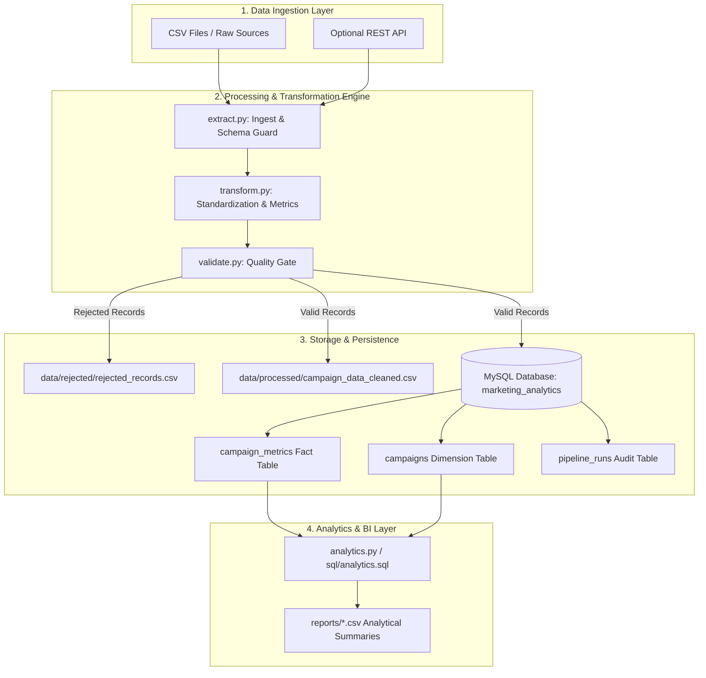

# System Architecture & Design Specification

## Overview

The Marketing Campaign Data Pipeline is a modular, production-ready ETL pipeline designed to extract advertising data from flat files or REST endpoints, cleanse and standardize dirty inputs, validate records against business rules, and load high-quality measurements into a relational star-schema storage layer in MySQL for BI and SQL analytics.

---

## Architecture Diagram

---

## Architectural Principles

1. **Modularity & Separation of Concerns**:
   - `extract.py`: Schema validation, I/O handling, and ingestion metadata.
   - `transform.py`: String normalization, datetime standardization, type coercion, and formula calculations.
   - `validate.py`: Pure rule validation separating valid from rejected data.
   - `load.py`: Database connection lifecycle, idempotent SQL upsert operations, and transaction management.
   - `analytics.py`: Parameterized SQL execution and reporting export.
   - `pipeline.py`: Workflow coordinator.

2. **Idempotency & Safe Reruns**:
   - Natural source keys (`record_id` and `campaign_id`) enforce uniqueness.
   - Upsert mechanics (`ON DUPLICATE KEY UPDATE`) ensure that executing the pipeline multiple times over identical or overlapping input data updates existing facts without inflating record counts.

3. **Transaction Integrity**:
   - All batch database operations are executed inside explicit SQLAlchemy transactions (`engine.begin()`).
   - If an error occurs during batch insertion, the entire transaction rolls back cleanly, preventing partial commits.

4. **Observability & Auditability**:
   - Every pipeline run creates a unique `run_id` token and tracks start time, end time, status, processed/accepted/rejected/loaded counts in `pipeline_runs`.
   - Comprehensive structured logs are captured in `logs/pipeline.log`.
